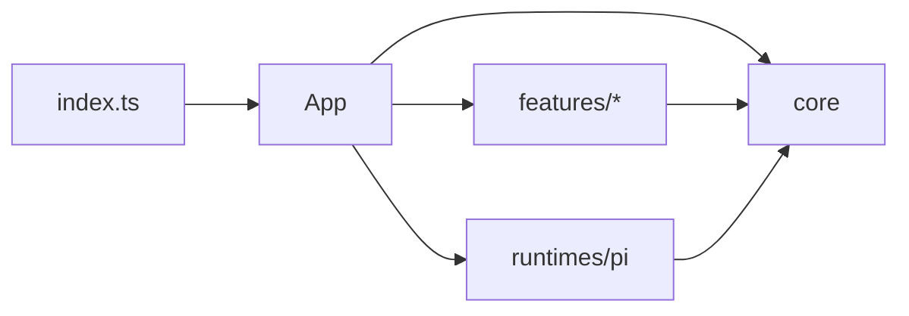

# quality-analysis-mcp

A stdio MCP server that exposes a [Pi](https://www.npmjs.com/package/@earendil-works/pi-coding-agent) agent to any MCP client. Agent-to-agent communication uses only MCP tool calls; it does not require sampling, elicitation, or client-specific extensions.

## Requirements

Bun >= 1.4.5 is the only supported runtime. Pi reuses its existing model and auth configuration (`~/.pi/agent` by default).

## Client configuration

```json
{
  "mcpServers": {
    "pi": { "type": "stdio", "command": "bun", "args": ["/absolute/path/src/index.ts"] }
  }
}
```

`bun run build` produces a single-file `dist/index.js` that can replace the source entry.

## Source layout

```text
src/
  index.ts                 entry: stdio transport, signals
  app.ts                   App: composition root
  config.ts                environment → Config
  server-instructions.md   MCP instructions
  core/                    kernel: contracts, session broker, @tool framework
  runtimes/pi/             AgentRuntime backed by the Pi SDK
  features/session/        ask_pi / reply_pi / cancel_pi
  features/checks/         check_* framework: CheckTool, scope resolution, Check contract
  features/checks/<name>/  one Check, e.g. test/
```

The layers are the kernel plus its three extension points: an agent backend implements `AgentRuntime` under `runtimes/`, a tool group extends `ToolModule` under `features/`, and a check implements `Check` under `features/checks/`. Dependencies point only toward `core`, and `App` is the only module that knows every layer:



`.oxlintrc.json` enforces these directions with `no-restricted-imports`:

- `core` imports nothing else from `src` and no agent SDK.
- `features` don't import `runtimes`, `app`, `config`, or the Pi SDK.
- `runtimes` don't import `features`, `app`, or `config`.

Inside `src`, imports across directories use the `@/` alias for `src/` (configured in `tsconfig.json` `paths`; vitest reads it through `resolve.tsconfigPaths`). Same-directory and child modules use `./`, and `../` is rejected. Tests import sources through `@/` as well.

## Prompts

Model-facing prose sits in a `prompts/` directory next to the code that reads it, loaded as Bun text imports and inlined into the build. Field-level parameter descriptions and one-line tool labels stay next to their schemas in code.

| Path                                                | Reader | Content                                                      |
| --------------------------------------------------- | ------ | ------------------------------------------------------------ |
| `src/server-instructions.md`                        | Host   | MCP `instructions`: the session protocol                     |
| `features/session/prompts/{ask,reply,cancel}-pi.md` | Host   | Session tool descriptions                                    |
| `runtimes/pi/prompts/system.md`                     | Pi     | Identity, tool restrictions, how to use `ask_host`           |
| `runtimes/pi/prompts/ask-host.md`                   | Pi     | `ask_host` tool description                                  |
| `features/checks/<name>/prompts/tool.md`            | Host   | `check_<name>` tool description                              |
| `features/checks/<name>/prompts/task.md`            | Pi     | Review procedure, severity scale, report format              |
| `features/checks/<name>/prompts/rubric.md`          | Pi     | Quality standard; may be a vendored copy of an external rule |

## Architecture

Components are classes that depend on interfaces and receive their dependencies through constructors. `App` is the only place that instantiates concrete classes; stateless algorithms such as scope resolution stay plain functions.

| Contract        | Defined in                 | Implemented by              | Role                                                   |
| --------------- | -------------------------- | --------------------------- | ------------------------------------------------------ |
| `AgentRuntime`  | `core/contracts.ts`        | `PiRuntime`                 | Agent backend that opens `AgentSession`s               |
| `HostChannel`   | `core/contracts.ts`        | broker's `Conversation`     | Lets a running agent ask the host and wait             |
| `SessionBroker` | `core/contracts.ts`        | `InMemorySessionBroker`     | Host-facing session protocol used by every tool        |
| `ToolModule`    | `core/tool-module.ts`      | `SessionTools`, `CheckTool` | Abstract class; `register` exposes its `@tool` methods |
| `Check`         | `features/checks/types.ts` | `TestCheck`                 | One `check_<name>` tool: prompts, target label, filter |

`new App(config, { runtime, checks })` accepts overrides, so tests or another agent backend can replace the Pi runtime and the check list without touching the tools.

### Decorators

`@tool(spec)` (TC39 standard decorators; no `experimentalDecorators`) declares a `ToolModule` method as an MCP tool. It registers the method on `register(server)`, adds the shared result `outputSchema`, wraps the returned `Result` as tool content, and converts thrown errors into `error` results. The method's parameter type must match `z.output` of `inputSchema`, which the type checker enforces. A spec function such as `@tool((self: CheckTool) => ({ name: ... }))` is evaluated at `register` time, so it can use constructor-injected fields.

Decorators are not used for dependency injection: standard decorators have no parameter decorators or type metadata, and explicit constructor wiring in `App` keeps every dependency visible and type-checked.

Vite's transformer does not lower standard decorators yet, so `vitest.config.ts` transpiles decorated modules with `Bun.Transpiler`; stack lines inside those modules are offset by the injected helpers.

### Adding a check

1. Create `src/features/checks/<name>/` with `prompts/{tool,task,rubric}.md` and a class implementing `Check` (`name`, `prompts`, `targetLabel`, `isTarget`); see `test/test-check.ts`.
2. Add an instance to `builtinChecks()` in `src/features/checks/index.ts`.

Scope resolution, the tool schema, prompt assembly (`task`, then `<rubric>`, `<files>`, optional `<host-instructions>`), and the session protocol are shared by every check.

## Protocol

| Tool                                               | Purpose                                              |
| -------------------------------------------------- | ---------------------------------------------------- |
| `ask_pi({prompt, session_id?})`                    | Start a task, or follow up on a completed session    |
| `reply_pi({session_id, question_id, answer})`      | Answer Pi's pending question and resume the same run |
| `cancel_pi({session_id})`                          | Abort or close a session; idempotent                 |
| `check_test({project_dir, scope?, instructions?})` | Review test file quality in a project scope          |

Every result is returned in `structuredContent`, with the same JSON in text content: `status` is `completed`, `needs_input`, `error`, or `closed`. When Pi calls its internal `ask_host` tool, the MCP call returns `needs_input` with `question_id` and `question`; the host answers it with `reply_pi`, which resolves the suspended Pi tool call rather than sending a new prompt. Each `reply_pi` returns the next `needs_input` or `completed`.

Pi has only the read-only `read`, `grep`, `find`, and `ls` tools plus `ask_host`; extensions, skills, prompt templates, and AGENTS files are not loaded. This is not an OS sandbox.

### `check_test`

Reviews test files against `src/features/checks/test/prompts/rubric.md`, a copy of `cmj_tools/rules/testing-quality.md`; update the copy when the source rule changes.

- `project_dir`: absolute project root; Pi's session runs there and also reads the code under test.
- `scope`: paths or globs relative to `project_dir`, default `["."]`. Directories and globs keep only test files, meaning `*.test.*` / `*.spec.*` scripts or scripts under `__tests__`, `test`, or `tests`; `node_modules`, `dist`, `build`, `coverage`, `out`, hidden directories, and `.d.ts` files are skipped. Explicit file paths are reviewed as given. Entries must stay inside `project_dir`.
- `instructions`: optional reviewer guidance, such as focus areas or report language.

The server rejects an invalid or empty scope, or one matching more than 50 test files, before calling the model. Otherwise it returns the same result shape as `ask_pi`: `text` holds a Markdown report with a summary, findings grouped by file with severity, `path:line`, evidence, impact, and suggestion, then risk-based gaps and limits. Use `ask_pi` with the returned `session_id` for follow-ups.

## Environment

| Variable                   | Default                  | Meaning                                               |
| -------------------------- | ------------------------ | ----------------------------------------------------- |
| `PI_PROVIDER` + `PI_MODEL` | Pi default model         | Model override; set both or neither                   |
| `PI_AGENT_DIR`             | Pi SDK default directory | Existing Pi auth, models, and settings directory      |
| `PI_CWD`                   | Process cwd              | Workspace Pi inspects                                 |
| `PI_RUN_TIMEOUT_MS`        | `300000`                 | Whole-turn deadline, including waiting for `reply_pi` |
| `PI_IDLE_TIMEOUT_MS`       | `1800000`                | Retention for completed sessions                      |
| `PI_MAX_SESSIONS`          | `8`                      | Concurrent session limit                              |

## Limits

Sessions and suspended questions live only in the server process: there is no persistence or crash recovery, and no token-level streaming. A run deadline or MCP request cancellation closes the affected session. OAuth refresh may update Pi's `auth.json`; settings are never written.
